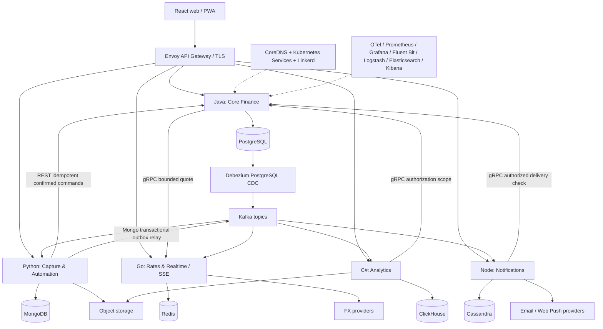

# Architecture and service boundaries

## 1. Architectural decision

Exactly five independently deployable application microservices implement five bounded contexts. Each owns its database, migrations, credentials, API, events, test suite and deployment chart. Web frontend, Envoy Gateway, CoreDNS, identity provider, Kafka, Kafka Connect/Debezium, object storage, monitoring agents and database operators are infrastructure or presentation workloads, not extra domain microservices. Do not create a sixth application BFF, scheduler, authentication service or standalone OCR service. Worker roles run from their owning service's codebase/image under separate Deployments when scaling independently is useful.

Five database products are compulsory and exclusive for application state. Elasticsearch is compulsory logging infrastructure; it stores redacted operational logs, not application financial records or a sixth shared domain database. Object storage stores attachment/export bytes, not financial records; metadata belongs to the owning database. An external OIDC provider manages credentials outside the application data boundary. These classifications must be visible in diagrams and assessment documentation.

Arrows depict selected interactions, not permission to connect to another service's database. Only each service's own credentials can reach its database. Projections of another context are allowed only through documented versioned events, with source ID/version and clear ownership.

## 2. Java / PostgreSQL — Core Finance

**Why this boundary:** transactions, account balances, obligations, budgets, approval decisions and reimbursement amounts require relational constraints and atomic writes. Keeping these related invariants inside one bounded context avoids distributed transactions for basic financial activity. This is a deliberately broad finance context with internal modules, not five arbitrary CRUD services.

**Owns:** users mapped to OIDC subjects; workspaces; memberships; permissions; preferences; accounts; account opening entries; chart/category definitions; merchants/vendors; transaction drafts and posted journal; splits; tax lines; FX snapshots; transfers/refunds; bills and occurrences; subscriptions and price history; due schedules; budgets/goals; household settlements; dimensions; business claims and approvals; reimbursements; policies; comments; report definitions; integration enrollment; provider token ciphertext; reminder preferences; calendar feed grants; API token hashes; retention/closure jobs; command idempotency; audit and transactional outbox.

**Internal modules:** identity/workspaces, ledger, obligations, planning, collaboration, business spend, integration coordination and retention. Enforce module APIs and prevent arbitrary repository access across modules. Shared value types include Money, WorkspaceId, LocalDueDate, AggregateVersion and IdempotencyKey. Use a transactional journal and explicit state machines, not controllers calling unrelated table repositories.

**Technology:** supported LTS JDK chosen and pinned at bootstrap; Spring Boot, Spring Security resource server and OAuth2 client; Spring Modulith or architecture tests for internal boundaries; jOOQ for explicit SQL and financial queries; PostgreSQL JDBC; Flyway migrations; Jakarta Bean Validation; Resilience4j; grpc-java with protobuf; Micrometer/OTel; JUnit, Testcontainers, ArchUnit. Gradle wrapper and dependency locking. Use PostgreSQL NUMERIC precision, bounded amounts and BigDecimal. Do not mix JPA and jOOQ for the same aggregate.

**Schema:** all tenant tables include workspace_id, foreign keys include tenant identity where practical, and indexes begin with workspace for common queries. UUID/ULID IDs are generated with safe monotonic ordering assumptions documented. journal_transactions owns kind, effective date, immutable facts and aggregate version; journal_lines owns account/currency/debit/credit/base values. Enforce balancing through a transactional posting procedure or deferred constraint trigger, tested under concurrency. Store categories and allocations separately from journal semantics. Outbox rows share the financial transaction. Consumer inbox rows share transactions with derived effects.

**Consistency:** ACID for posting, paired transfers, bill payment allocation, approval transitions, budget moves and memberships. Use row locks for outstanding balance/approval stage and optimistic version checks for editors. Transaction isolation must be chosen per command; default read committed with targeted locks and serialization retries for commands requiring serializable invariants. Never assert serializable behavior from default isolation alone. Enable RLS defense in depth with request-scoped tenant context, pooled-connection reset and separate migration role.

**Operational behavior:** recurrence scheduler is a worker role in this service. It claims due work using PostgreSQL locking and produces occurrences/reminder intents in the same transaction. It scans overdue/eligible rows in bounded batches and periodically reconciles the future horizon. Jobs are recoverable after pod restart. It never relies on a JVM in-memory timer as the sole scheduler.

**Does not own:** receipt OCR bytes, editable classification rules, currency provider cache, report fact storage, email delivery attempts or provider passwords. It stores final accepted category and immutable booked FX evidence because those are financial facts.

## 3. Python / MongoDB — Capture & Automation

**Why this boundary:** heterogeneous import files, extraction results, rule trees and staging documents have changing shapes. They are workflow documents, not the definitive ledger.

**Owns:** import jobs/row staging, mappings, statement cursors, receipt metadata/extraction versions, attachment associations proposed before confirmation, rule definitions/version history, merchant matching indexes, categorization suggestions, anomaly suggestions, recurring candidates, inbound email ingestion/quarantine and capture job status. MongoDB transactions require a replica set even locally. Transactional writes persist document changes and outbox documents together.

**Technology:** supported Python release; FastAPI, Pydantic, Uvicorn; official PyMongo async API after verifying compatibility; httpx; confluent-kafka; tenacity with bounded retries; grpcio; OpenTelemetry; pytest and container fixtures. CSV via Python csv with strict parsing; OFX/QFX via maintained OFX parser verified with fixtures. Receipt processing: Tesseract via pytesseract, Pillow, pypdf/pdf rendering tool with sandbox/process limits, python-magic or trusted MIME detection. Do not introduce a Celery Redis broker that shares Go's database.

**Workers:** API role stages work and persists intent; worker role consumes Kafka capture jobs and processes bounded batches with Mongo job leases. Lease expiry is based on persisted time/version and workers are idempotent. One OCR worker process per allotted CPU slot initially; cap image pixels/pages, execution time and memory; isolate risky converters as non-root subprocesses with no network.

**Import flow:** upload signed attachment, inspect/scan, parse into staged rows, choose mapping/account/date/currency, normalize into canonical drafts, detect exact provider IDs and probable duplicates, show preview, confirm selected rows, issue Java commands with deterministic keys, persist result per row, mark summary complete after every acknowledged outcome. A crash after Java commits but before Mongo records success is recovered by replaying the same key. No cross-database transaction is claimed.

**Rules:** declarative bounded expressions; no eval, arbitrary Python, user regex without bounds or unbounded regex catastrophic backtracking. Conditions cover merchant, memo, account, amount ranges, currency, direction, weekday, source and category-empty. Actions propose category/tags/merchant normalization/project/recurring candidate, never approval or payment. Rule version persisted with each suggestion. A simple keyword/merchant baseline is sufficient; no external AI required.

**Own database rules:** unique indexes on workspace + provider + external ID and workspace + import row fingerprint where appropriate. Partition huge jobs into documents rather than an array exceeding Mongo document size. TTL only for expired staging/quarantine after retention checks; never TTL accepted receipts still linked to retained ledger. Events relay by polling Mongo outbox with leases; acknowledgement after Kafka publish may duplicate, so consumers deduplicate. This relay is application outbox publishing; PostgreSQL CDC remains the mandatory CDC implementation. Do not configure the PostgreSQL Debezium EventRouter against MongoDB.

**Cross-context interaction:** final confirmation requires Java authorization and idempotent command; a suggestion event does not autonomously post spend. Java records authorized attachment link after Python validates workspace ownership and safe file state. Failure can leave an unattached receipt, which cleanup later reconciles.

## 4. Go / Redis — Rates & Realtime

**Why this boundary:** exchange quote fan-out, websocket-like updates and short-lived coordination need low latency and bounded memory. Redis is suited to recoverable data; it must never be the only storage for financial truth or guaranteed renewal tasks.

**Owns:** latest/historical provider quote cache, freshness markers, SSE ephemeral resume buffers, per-instance coordination for quote polling, provider quota counters, client connection metadata and low-risk cache entries. All are reconstructable from providers, Kafka or owning service APIs. No sessions, membership truth, bill schedule, money balance or durable task queue is stored only in Redis.

**Technology:** supported Go toolchain; net/http with chi router, go-redis, grpc-go, franz-go Kafka client, decimal library verified against Java money fixtures, gobreaker, OpenTelemetry, Prometheus middleware. Use context deadlines and bounded goroutines, bounded channels and graceful shutdown. Standard testing and race detector. Avoid bringing multiple routing/framework stacks into a small service.

**Quote API:** latest pair/date batch queries, provider metadata, supported currencies, reference-rate histories and normalized conversion preview. Cache quotes once per provider/base/date and derive safe cross rates with provenance. Acquire a short advisory poll lease; duplicate refresh is harmless. Provider quota/rate limits are enforced before egress. Fetch daily references on publication-aware intervals; do not hammer a daily API every second. Persist accepted quote copies in Java with the transaction.

**Realtime:** browser subscribes to its workspace stream using secure same-origin cookie/auth mechanism. Java authorizes stream opening; caches permission for a maximum short lease and disconnects on revocation event. Redis Pub/Sub distributes invalidation messages across replicas, Kafka supplies durable domain events, and a bounded Redis Stream supports recent resumptions. Stream contains IDs, versions and invalidation type, not full sensitive financial payload. On missed cursor, cache loss or reordered message, send resync and frontend refetches authoritative data.

**Failure:** Redis down means reduced realtime and temporary quote fetch fallback subject to rate limits. Stale known reference quote may be displayed, never silently accepted as current. Manual actual conversion remains available with recorded provenance. Connection spikes must not starve quote endpoints. Redis AOF/RDB aid restart but do not justify durable-only storage guarantees.

## 5. C# / ClickHouse — Analytics

**Why this boundary:** multidimensional trends and comparison scans belong to a columnar read model. ClickHouse serves analysis, not approval writes or account balance truth.

**Owns:** versioned transaction/line fact projections, obligation snapshots, budget/claim transitions, anonymized operational product metrics, rebuild run records and projection watermarks. Saved report definitions/schedules are business configuration in Java; Analytics accepts a validated query spec and owns only derived analytics. Export bytes go to object storage, with job state coordinated by Java and derived generation status in ClickHouse.

**Technology:** supported .NET LTS release; ASP.NET Core minimal APIs, official-supported/actively maintained ClickHouse .NET driver selected after integration tests, Confluent.Kafka, Grpc.Net.Client, Polly, FluentValidation, OpenTelemetry and xUnit. Dapper only if selected driver's parameterization is verified; raw SQL with typed parameters is sufficient. Do not invent Entity Framework transactions over ClickHouse.

**Ingestion:** consume Kafka after authorization-approved, curated events; persist source event ID, source aggregate version, tombstone and immutable partition key. Commit Kafka offsets only after acknowledged ClickHouse insertion. Retries can duplicate insertions. ReplacingMergeTree plus version-aware queries provides logical idempotency; storage is not magically exactly once. Do not sum raw duplicated facts or feed naive insert-triggered sums into an irreversible total.

**Correctness:** use `argMax` over immutable object IDs/version and tombstone filtering, or bounded `FINAL` queries verified for selected schema. Partition each fact by immutable creation-month, not editable effective date, so revisions stay in one partition. Filter date/category/permission on the resolved latest row, avoiding excluded corrections. For performance create refreshable/recomputed aggregates from deduplicated current facts and explicit reconciliation, not summing every replayed delta. Dataset epoch/rebuild ID isolates new projection from active reads; swap active epoch only after reconciliation.

**Query limits:** whitelist dimensions, time grains, metrics and operators. Never concatenate user SQL. Every query has workspace/scoped object predicates, row limits, memory/time caps and export limits. C# verifies authorization with Java; it must fail closed for sensitive reports if it cannot validate membership. Show per-workspace projection freshness and consumed partition offsets; report response includes `asOf` and `lagSeconds`. A wall-clock watermark alone cannot prove cross-partition completeness.

**Reports:** spend/income/net flow, category/budget progress, subscription annual commitments, price movements, cash forecast, vendor concentration, department/projects, claims aging/approval time, tax summary, monthly/annual review and saved report executions. Financial commands never trust these eventual aggregates to approve reimbursement or overdraft-sensitive actions.

## 6. Node.js / Cassandra — Notifications

**Why this boundary:** notification timelines and provider attempt histories are append-heavy, time-bucketed and queried by recipient. Cassandra serves durable high-volume communication records; the finance service owns why and when a reminder is due.

**Owns:** recipient notification intent/status, inbox indexes, delivery attempts, bounce/suppression state, provider delivery receipts, signed outbound webhook attempts and per-channel dedup claims. Java owns preferences and authoritative eligibility; Notifications stores projections with source versions. It receives already-due intents rather than maintaining the finance schedule.

**Technology:** supported Node LTS, TypeScript strict mode, Fastify, Zod, cassandra-driver, maintained Kafka client selected with failure tests, grpc-js, Nodemailer SMTP, AWS SES SDK, web-push, OpenTelemetry and Vitest. Node service does not get a PostgreSQL/Mongo/Redis dependency. Use bounded provider concurrency and keep retries within this service.

**Tables and consistency:** query-driven tables for recipient-month inbox, intent delivery state, attempt history, provider message mapping and suppression. Month buckets prevent unlimited partitions. Use LOCAL_QUORUM for important reads/writes with replication factor 3 in production and appropriate LOCAL_SERIAL for LWT. Stable intent ID is derived from workspace, occurrence, recipient, channel, schedule version and reminder offset; retries share it. Delivery state and attempt claims colocate within a single intent partition where CAS is needed. Denormalized inbox indexes are repairable and not transactionally atomic with the primary intent partition.

**Consumer flow:** persist primary intent, reconcile inbox projection, acknowledge Kafka only after durable primary write. On crash replay repairs incomplete index. Use LWT for claim/version transitions and expiring delivery lease. Poll retry buckets as repairable indexes, validate source primary intent and version before delivery, and periodically repair missing buckets from retained Kafka source or intent inventory. Explicitly exercise crash after primary persist but before bucket insert; Kafka offset must not commit before mandatory retry index persistence. Cross-partition batches cannot create global ACID guarantees.

**Preflight:** request Java eligibility just before send: occurrence not paid/canceled, schedule version unchanged, recipient still authorized, channel/preference eligible. Quiet hours and digests originate from Java's due intent scheduling; delivery worker still validates current preferences. If Java unavailable, postpone financial reminders rather than use stale permission. Notification events for SSE are delivered through Kafka after persisted inbox projection; a retry-safe pending-publish marker in intent state is swept and republished. No Cassandra CDC is required.

**Email guarantee:** at-least-once attempt with stable provider key when supported. Crash after provider accepted but before local result can cause an ambiguous outcome. SMTP cannot guarantee exactly-once email; mark unknown, attempt provider reconciliation when possible, and apply a documented bounded ambiguity policy rather than claiming zero duplicates. In-app inbox is logically once by deterministic intent ID. Keep provider IDs and attempt history for troubleshooting.

## 7. Discovery, gateway and resilience

CoreDNS plus Kubernetes Services is the Discovery Service: `core-finance.ledgerline.svc.cluster.local`, etc. Use headless services for databases and operator-managed membership. Do not add Eureka or Consul to duplicate Kubernetes discovery. Include a discovery demonstration: replace a pod, observe endpoint changes, and successfully call the stable service name.

Envoy Gateway implements Gateway API routes, public TLS, request limits, auth integration, HTTP/grpc routing and backend connection circuit thresholds. Only gateway/load balancer ports are public. It does not perform financial business logic. Browser API requests route by `/api/v1/core`, `/capture`, `/rates`, `/analytics`, `/notifications`; same-origin cookies and CSRF validation apply. SSE has a distinct idle-timeout policy and upstream connection limits.

Use Linkerd for workload mTLS identity and policy; injected proxies provide the required demonstrable multi-container application pods. Pin a supported mesh/gateway pairing and validate pod security requirements of proxy initialization. Use mesh CNI where necessary so application pods don't need broad network capabilities. Mesh is infrastructure, not sixth service.

Java Resilience4j, Python bounded retry/breaker wrapper, Go gobreaker, .NET Polly and Node bounded breaker implement application dependency isolation. Starting internal RPC deadline 500ms for permission/quote checks, public read deadline 3s, command deadline 5s; long tasks return 202. Limit gRPC calls per public request to avoid chains. Retry only idempotent reads or keyed commands at one agreed layer, maximum two retries with jitter and budget; don't multiply gateway, mesh and client retries. Start breaker window at 20 calls, 50% failure threshold, 15s open and two half-open probes; tune after measured load. Limits are starting settings, not universal production values.

## 8. Synchronous and asynchronous communication

REST handles browser CRUD and confirmed cross-service commands. gRPC handles bounded typed internal quote/auth/delivery eligibility requests. Kafka handles domain events, capture jobs, analytics projections and notification intents. Kafka is the sole required durable broker; adding RabbitMQ alongside it is not justified here.

Topics are grouped by producer/domain with versioned schemas, e.g. `ll.finance.v1`, `ll.capture.v1`, `ll.notification-intents.v1`, `ll.notifications.v1`, `ll.integration-jobs.v1`; dead-letter topics mirror consumers. Key financial events by workspace+aggregate ID; ordering is only per partition. Do not assume ordering across topics. Use aggregate versions, stale-event rejection and consumer inboxes. Sensitive payloads are minimal and retention scoped. Avro/Protobuf/JSON Schema registry is chosen once; use JSON Schema initially for readable cross-language contracts, enforce compatibility in CI and registry.

PostgreSQL transactional outbox is captured by Debezium logical replication and routed to Kafka. Domain write and outbox insert share ACID transaction. Manage replication slots, WAL growth, connector offsets, schema changes and least-privilege replication account. Outbox data may be purged only after confirmed connector progress and retention requirements. Capture raw CDC only inside infrastructure; public domain events contain curated fields and no secrets.

Cross-service workflows are orchestrated by the authoritative service with persisted job/version state; no distributed two-phase commit. Import confirmation uses idempotent Java commands. Attachment linking retries safely. Workspace deletion emits versioned purge commands and records acknowledgements from P/C/N; G flushes ephemeral caches. Failed purge stays visible and recoverable. Member revocation is checked on every API and during delivery preflight, so event lag cannot authorize access.

CQRS means Java command model plus Java indexed operational read models and C# analytical projections. It does not require two databases inside every service. ACID applies where actually implemented in PostgreSQL/Mongo transactions; BASE/eventual applies to cross-service projections, notification indexes and Redis recoverable state. Explain these choices in final assessment, including limitations of Cassandra LWT and ClickHouse merge-time deduplication.
